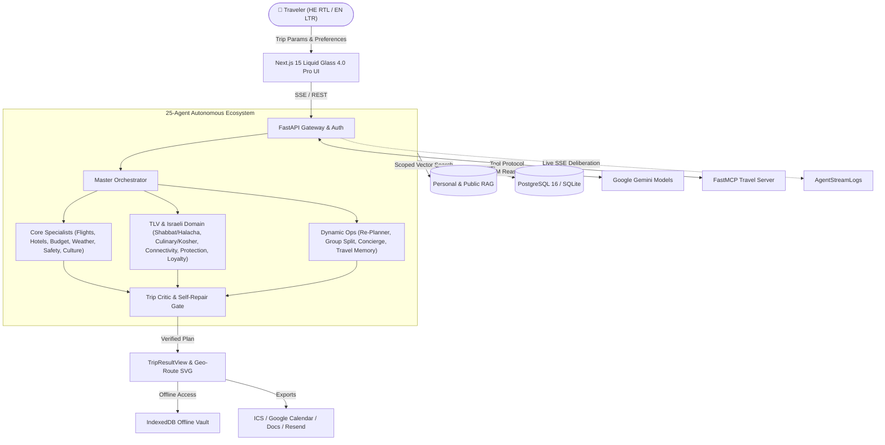

# 🌍 Wanderlust Voyage AI — AgentTravelPlanner ✈️

<div align="center">


### **Autonomous 25-Agent Multi-Agent Travel Orchestration Platform**
*Powered by 25 Cooperating Specialist & Meta AI Agents, Personal RAG, FastMCP, Real-Time SSE Deliberation Streaming, Next.js 15 (BiDi RTL/LTR), and FastAPI.*

[](https://github.com/IDAN2468D/wanderlust-voyage-ai/actions/workflows/ci.yml)
[](https://nextjs.org/)
[](https://react.dev/)
[](https://fastapi.tiangolo.com/)
[](https://www.python.org/)
[](https://ai.google.dev/)
[](https://www.postgresql.org/)
[](https://www.docker.com/)
[](https://tailwindcss.com/)

[🌐 Live Frontend](http://localhost:3000) • [⚡ Backend API](https://wanderlust-voyage-ai.onrender.com) • [📚 Interactive Swagger Docs](https://wanderlust-voyage-ai.onrender.com/docs) • [🧭 Agent Suite (25)](.agents/agents.json)

</div>

---

## 🌟 Overview

**Wanderlust Voyage AI (AgentTravelPlanner)** replaces dozens of hours of stressful flight hunting, hotel reviews, manual budget calculations, Shabbat/kosher logistics, and itinerary assembling with an **autonomous committee of 25 specialist & meta AI agents** governed by a **Spec-First 5-Layer Agent Stack**.

The platform executes deterministic reasoning, queries live flight/hotel/FX/weather feeds with resilient fallbacks, isolates personal user documents in a **Personal RAG Vector Store**, exposes tools over **FastMCP**, enforces quality via a **Trip Critic Gate**, and streams live thought deliberation via **Server-Sent Events (SSE)** to a **Liquid Glass 4.0 Pro** BiDi (`HE` RTL ↔ `EN` LTR) interface.

---

## 🤖 The 25 Autonomous Specialist & Meta Agents

Every step of the travel lifecycle is assigned to a registered agent in [`.agents/agents.json`](.agents/agents.json) and verified by [`.agents/scripts/verify_agent_suite.py`](.agents/scripts/verify_agent_suite.py):

### Core & Domain Specialists (1–16)
| # | Specialist Agent | Codename | Primary Responsibility & Toolset |
|---|------------------|----------|-----------------------------------|
| 1 | 🧭 **Master Orchestrator** | `travel_orchestrator` | Coordinates multi-agent deliberation, manages SSE streaming, synthesizes end-to-end plans, and persists memory. ([`orchestrator.py`](backend/app/agents/orchestrator.py)) |
| 2 | ✈️ **Flight Search Engine** | `flight_search_agent` | Evaluates direct vs. layover flights from TLV, filters blocked carriers, calculates checked baggage & arrival timings. ([`flight_tools.py`](backend/app/tools/flight_tools.py)) |
| 3 | 🏨 **Places & Hotel Curator** | `places_hotel_agent` | Curates 8.8+ rated boutique hotels, resorts, and attractions with Nominatim enrichment & Google Maps links. ([`places_tools.py`](backend/app/tools/places_tools.py)) |
| 4 | 💰 **Budget & Currency Optimizer** | `budget_agent` | Live tri-currency conversions (₪ ILS, $ USD, € EUR) via Frankfurter FX API + mandatory 10% contingency buffer. ([`budget_tools.py`](backend/app/tools/budget_tools.py)) |
| 5 | ⛅ **Weather & Packing Optimizer** | `weather_packing_agent` | Open-Meteo climate forecasts, day/night delta, rain probability, and tailored packing checklists. ([`weather_tools.py`](backend/app/tools/weather_tools.py)) |
| 6 | 🎭 **Culture & Events Specialist** | `events_agent` | Seasonal festivals, concerts, sunset viewpoints, and cultural highlights. ([`events_tools.py`](backend/app/tools/events_tools.py)) |
| 7 | 🛡️ **Safety & Health Advisor** | `safety_agent` | Passport validity checks (6+ months), emergency hotlines, Israeli embassy contacts, and travel advisories. ([`safety_tools.py`](backend/app/tools/safety_tools.py)) |
| 8 | 🚇 **Transit & Metro Navigator** | `transit_agent` | City transit passes (Navigo, Oyster, Roma Pass), airport shuttles, walkability scores, and navigation tips. ([`transit_tools.py`](backend/app/tools/transit_tools.py)) |
| 9 | 🍽️ **Culinary & Kosher Guide** | `culinary_agent` | Glatt kosher restaurants, Chabad centers with map links, regional signature dishes, and tipping etiquette. ([`culinary_tools.py`](backend/app/tools/culinary_tools.py)) |
| 10 | 🛍️ **Shopping & Tax-Free Specialist** | `shopping_agent` | National VAT refunds (France, Italy, Spain), airport customs kiosks (PABLO, DIVA, Otello), and outlets. ([`shopping_tools.py`](backend/app/tools/shopping_tools.py)) |
| 11 | 📅 **Calendar & Workspace Syncer** | `calendar_sync_agent` | RFC 5545 `.ics` calendar packs with flight alarms + 1-click Google Calendar, Docs, and Resend email sync. ([`calendar_tools.py`](backend/app/tools/calendar_tools.py)) |
| 12 | 🚨 **Ground Sentinel & Alert Agent** | `sentinel_agent` | Scans transport strike risks, tourist scam alerts, and emergency embassy dispatch. ([`sentinel_tools.py`](backend/app/tools/sentinel_tools.py)) |
| 13 | 📱 **WhatsApp Concierge Butler** | `whatsapp_butler` | Formats day-by-day itineraries into clean WhatsApp briefings with 1-click copy & share. ([`briefing_tools.py`](backend/app/tools/briefing_tools.py)) |
| 14 | 🛫 **TLV Holiday Flight Board Agent** | `tlv_flight_board_agent` | Tracks Israeli holiday windows, Shabbat flight conflicts, and true baggage-inclusive airfare from Ben Gurion. ([`tlv_flight_board_tools.py`](backend/app/tools/tlv_flight_board_tools.py)) |
| 15 | 🧠 **RAG Knowledge Retriever** | `rag_knowledge_agent` | Bilingual vector search across curated destination guides and isolated personal traveler documents. ([`retriever.py`](backend/app/rag/retriever.py)) |
| 16 | 🔌 **MCP Tool Gateway** | `travel_mcp_gateway` | Exposes deterministic travel, replanning, and readiness tools via FastMCP for external AI clients. ([`travel_mcp_server.py`](backend/app/mcp/travel_mcp_server.py)) |

### Sprint 8 & 9 Autonomous Specialists & Quality Gate (17–25)
| # | Specialist Agent | Codename | Primary Responsibility & Toolset |
|---|------------------|----------|-----------------------------------|
| 17 | 🔄 **Dynamic Day Re-Planner** | `replan_agent` | Detects weather/strike/budget conflicts, swaps individual day slots with live SSE streaming, and computes structured diffs. ([`replan_tools.py`](backend/app/tools/replan_tools.py)) |
| 18 | 👥 **Group Split & Consensus Agent** | `group_split_agent` | Splits multi-traveler budgets (equal/weighted/adult-child tracks), builds settlement ledgers, and tallies group votes. ([`group_split_tools.py`](backend/app/tools/group_split_tools.py)) |
| 19 | 🪪 **Traveler Memory & Passport Agent** | `travel_memory_agent` | Persists dietary/seating preferences in DB and validates passport expiration windows against destination rules. ([`memory_tools.py`](backend/app/tools/memory_tools.py)) |
| 20 | 🕯️ **Shabbat & Halacha Strategist** | `shabbat_halacha_agent` | Computes candle-lighting/Havdalah estimates, Chabad walking radius, and Shabbat-safe zero-transit scheduling. ([`shabbat_halacha_tools.py`](backend/app/tools/shabbat_halacha_tools.py)) |
| 21 | 📶 **Connectivity & Mobility Specialist** | `connectivity_mobility_agent` | Recommends destination eSIM plans, local SIMs, airport transfers, and accessible mobility routing. ([`connectivity_mobility_tools.py`](backend/app/tools/connectivity_mobility_tools.py)) |
| 22 | ⚖️ **Protection & Passenger Rights Agent** | `protection_rerouting_agent` | Audits travel insurance riders, Israeli Aviation Services Law (Tibi Law) / EU261 compensation, and Plan-B rerouting. ([`protection_rerouting_tools.py`](backend/app/tools/protection_rerouting_tools.py)) |
| 23 | 💎 **Loyalty & Vault Readiness Agent** | `loyalty_vault_agent` | Evaluates points-vs-cash redemption (Matmid, Flying Blue, Miles & More), lounge access, and entry form readiness. ([`loyalty_vault_tools.py`](backend/app/tools/loyalty_vault_tools.py)) |
| 24 | 🛎️ **Pre-Departure Concierge** | `pre_departure_concierge` | Generates milestone readiness timelines (T-30d to T-24h) and runs active booking anomaly watchdog scans. ([`concierge_tools.py`](backend/app/tools/concierge_tools.py)) |
| 25 | ✅ **Trip Critic & Self-Repair Gate** | `trip_critic_agent` | Audits every generated plan for budget consistency, map links, Shabbat compliance, and auto-repairs gaps before delivery. ([`critic.py`](backend/app/agents/critic.py)) |

---

## ✨ Key Features

- **⚡ Transparent SSE Deliberation Stream:** Real-time agent reasoning cards stream every specialist stage directly to the UI (`AgentStreamLogs.tsx`).
- **🌐 Full BiDi Localization (`HE` RTL ↔ `EN` LTR):** Instant language & direction toggle (`LocaleContext.tsx`) with Israeli `DD/MM/YYYY` dates, TLV Hub live ticker, and `₪ ILS / $ USD / € EUR` live FX conversion.
- **🔄 Co-Pilot Day Re-Planner Drawer:** Lock/pin favorite days and swap morning/afternoon/evening slots on demand with live SSE diff previews.
- **🗺️ Geo-Route & Shabbat Walking Radius Map:** Interactive SVG route canvas toggling between multi-day itinerary flow and Shabbat-safe Chabad walking radius.
- **👥 Group Cost Split & Live Voting:** Multi-traveler cost breakdown, settlement ledger, and collaborative activity voting persisted in PostgreSQL/SQLite.
- **🔐 Personal RAG Isolation & DB-Persisted HITL:** User-uploaded travel notes are scoped strictly by `owner_user_id`; Human-in-the-Loop approvals (`PendingActionModel`) persist safely across restarts.
- **📱 Offline Vault (IndexedDB):** Save confirmed boarding passes and itineraries directly to browser IndexedDB (`offlineVault.ts`) for zero-connectivity access abroad.
- **💳 Complete Booking Cockpit & Workspace Sync:** Interactive checkout, RFC 5545 `.ics` calendar export, Google Calendar/Docs export, and Resend transactional email briefings.

---

## 🏗️ Architecture & Dataflow



---

## 🚀 Getting Started

### Prerequisites
- [Docker](https://www.docker.com/) & [Docker Compose](https://docs.docker.com/compose/)
- [Node.js 20+](https://nodejs.org/)
- [Python 3.11+](https://www.python.org/)
- [Google Gemini API Key](https://ai.google.dev/)

### Option 1: Docker Compose (Recommended) 🐳

1. **Clone & enter the repository:**
   ```bash
   git clone https://github.com/IDAN2468D/wanderlust-voyage-ai.git
   cd wanderlust-voyage-ai
   ```
2. **Configure environment variables:**
   ```bash
   cp .env.example .env
   cp backend/.env.example backend/.env
   # Set GEMINI_API_KEY in .env
   ```
3. **Start all services:**
   ```bash
   docker compose up --build -d
   ```
   - **Frontend Portal:** [http://localhost:3000](http://localhost:3000)
   - **FastAPI Backend API:** [http://localhost:8000](http://localhost:8000)
   - **Swagger Docs:** [http://localhost:8000/docs](http://localhost:8000/docs)

### Option 2: Local Development 💻

#### Backend
```bash
cd backend
python -m venv .venv
source .venv/bin/activate   # Windows: .venv\Scripts\activate
pip install -r requirements.txt
uvicorn app.main:app --reload --port 8000
```

#### Frontend
```bash
cd frontend
npm install
npm run dev
```

---

## 📡 Key API Endpoints

| Method | Path | Description |
|--------|------|-------------|
| `GET` | `/health` | Service health, version, and active Gemini model status |
| `GET` | `/api/v1/trips/stream` | Real-time SSE channel streaming 25-agent deliberation & synthesis |
| `POST` | `/api/v1/trips/plan` | Synchronous trip compilation with Critic audit |
| `POST` | `/api/v1/trips/{session_id}/replan` | Dynamic day/slot re-planner with structured diff |
| `POST` | `/api/v1/trips/{session_id}/replan/stream` | Real-time SSE day re-planning stream |
| `POST` | `/api/v1/trips/{session_id}/group-split` | Multi-traveler cost split & settlement ledger |
| `POST` / `GET` | `/api/v1/trips/{session_id}/vote` & `/votes` | Collaborative itinerary voting & tally |
| `GET` / `PUT` | `/api/v1/profile/preferences` | Persistent traveler memory & preferences |
| `POST` | `/api/v1/knowledge/ingest-personal` | Owner-isolated Personal RAG document ingestion |
| `GET` | `/api/v1/bookings/{booking_ref}/readiness` | Pre-departure milestone timeline & watchdog |
| `GET` | `/api/v1/ops/live-pulse` & `/ops/metrics` | Live TLV FX rates (Frankfurter) & system telemetry |

---

## 🧪 Testing & Verification

```bash
# 1. Backend full test suite (76 tests) & syntax lint
cd backend
.venv/bin/pytest tests/ -v
.venv/bin/flake8 app/ --select=E9,F63,F7,F82 --show-source --statistics

# 2. Spec & 25-agent suite contract check
cd ..
python3 .agents/scripts/verify_agent_suite.py

# 3. Frontend TypeScript & production build
cd frontend
npx tsc --noEmit && npm run build
```

---

## 📄 License

Distributed under the **MIT License**. See [`LICENSE`](LICENSE) for details.

<div align="center">

**Built with ❤️ for passionate travelers worldwide by the Wanderlust Voyage AI Team.**

</div>
