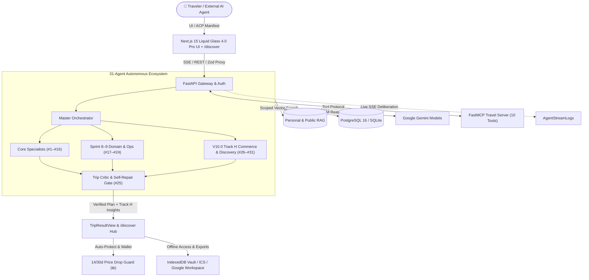

# 🌍 Wanderlust Voyage AI — AgentTravelPlanner ✈️

<div align="center">


### **Autonomous 31-Agent Multi-Agent Travel & Agentic Commerce Platform (V10.0 — Track H)**
*Powered by 31 Cooperating Specialist, Meta & Agentic Commerce AI Agents, ACP/UCP Delegated Checkout, Proactive Travel Radar, Vision Lookbook Matching, Post-Booking Price Drop Guard, Personal RAG, FastMCP, Real-Time SSE Streaming, Next.js 15 (BiDi RTL/LTR), and FastAPI.*

[](https://github.com/IDAN2468D/wanderlust-voyage-ai/actions/workflows/ci.yml)
[](https://nextjs.org/)
[](https://react.dev/)
[](https://fastapi.tiangolo.com/)
[](https://www.python.org/)
[](https://ai.google.dev/)
[](https://zod.dev/)
[](https://www.postgresql.org/)
[](https://www.docker.com/)
[](https://tailwindcss.com/)

[🌐 Live Frontend](http://localhost:3000) • [🛰️ Discover Hub (/discover)](http://localhost:3000/discover) • [⚡ Backend API](https://wanderlust-voyage-ai.onrender.com) • [📚 Swagger Docs](https://wanderlust-voyage-ai.onrender.com/docs) • [🧭 Agent Suite (31)](.agents/agents.json)

</div>

---

## 🌟 Overview

**Wanderlust Voyage AI (AgentTravelPlanner V10.0)** replaces dozens of hours of stressful flight hunting, hotel comparison, manual budget calculations, Shabbat/kosher logistics, and itinerary assembling with an **autonomous committee of 31 specialist, meta, and agentic-commerce AI agents** governed by a **Spec-First 5-Layer Agent Stack**.

Beyond end-to-end itinerary orchestration, **V10.0 (Track H)** transforms the platform into an **open ACP/UCP travel commerce & proactive discovery engine**: external AI agents (ChatGPT, Claude, Gemini) can discover inventory via a signed `/.well-known/agent-commerce.json` manifest and execute atomic delegated checkouts (`₪ ILS`), travelers can monitor deals via natural-language **Proactive Travel Interests**, decompose inspiration screenshots into bookable bounding-box hotspots with `-10%` bundles (**Screenshot-to-Trip**), protect confirmed trips with automated **14/30-day Price Drop Refunds** to a `₪` Travel Wallet, and trigger 1-click **Sidekick TravelOps Pulse** actions & bundle negotiations.

---

## 🤖 The 31 Autonomous Specialist, Meta & Commerce Agents

Every step of the travel lifecycle is assigned to a registered agent in [`.agents/agents.json`](.agents/agents.json) and verified by [`.agents/scripts/verify_agent_suite.py`](.agents/scripts/verify_agent_suite.py):

### Core & Domain Specialists (1–16)
| # | Specialist Agent | Codename | Primary Responsibility & Toolset |
|---|------------------|----------|-----------------------------------|
| 1 | 🧭 **Master Orchestrator** | `travel_orchestrator` | Coordinates multi-agent deliberation, manages SSE streaming, synthesizes end-to-end plans, and persists memory. ([`orchestrator.py`](backend/app/agents/orchestrator.py)) |
| 2 | ✈️ **Flight Search Engine** | `flight_search_agent` | Evaluates direct vs. layover flights from TLV, filters blocked carriers, calculates checked baggage & arrival timings. ([`flight_tools.py`](backend/app/tools/flight_tools.py)) |
| 3 | 🏨 **Places & Hotel Curator** | `places_hotel_agent` | Curates 8.8+ rated boutique hotels, resorts, and attractions with Nominatim enrichment & Google Maps links. ([`places_tools.py`](backend/app/tools/places_tools.py)) |
| 4 | 💰 **Budget & Currency Optimizer** | `budget_agent` | Live tri-currency conversions (`₪ ILS`, `$ USD`, `€ EUR`) via Frankfurter FX API + mandatory 10% contingency buffer. ([`budget_tools.py`](backend/app/tools/budget_tools.py)) |
| 5 | ⛅ **Weather & Packing Optimizer** | `weather_packing_agent` | Open-Meteo climate forecasts, day/night delta, rain probability, and tailored packing checklists. ([`weather_tools.py`](backend/app/tools/weather_tools.py)) |
| 6 | 🎭 **Culture & Events Specialist** | `events_agent` | Seasonal festivals, concerts, sunset viewpoints, and cultural highlights. ([`events_tools.py`](backend/app/tools/events_tools.py)) |
| 7 | 🛡️ **Safety & Health Advisor** | `safety_agent` | Passport validity checks (6+ months), emergency hotlines, Israeli embassy contacts, and travel advisories. ([`safety_tools.py`](backend/app/tools/safety_tools.py)) |
| 8 | 🚇 **Transit & Metro Navigator** | `transit_agent` | City transit passes (Navigo, Oyster, Roma Pass), airport shuttles, walkability scores, and navigation tips. ([`transit_tools.py`](backend/app/tools/transit_tools.py)) |
| 9 | 🍽️ **Culinary & Kosher Guide** | `culinary_agent` | Glatt kosher restaurants, Chabad centers with map links, regional signature dishes, and tipping etiquette. ([`culinary_tools.py`](backend/app/tools/culinary_tools.py)) |
| 10 | 🛍️ **Shopping & Tax-Free Specialist** | `shopping_agent` | National VAT refunds (France, Italy, Spain), airport customs kiosks (PABLO, DIVA, Otello), and outlets. ([`shopping_tools.py`](backend/app/tools/shopping_tools.py)) |
| 11 | 📅 **Calendar & Workspace Syncer** | `calendar_sync_agent` | RFC 5545 `.ics` calendar packs with flight alarms + 1-click Google Calendar, Docs, and Resend email sync. ([`calendar_tools.py`](backend/app/tools/calendar_tools.py)) |
| 12 | 🚨 **Ground Sentinel & Alert Agent** | `sentinel_agent` | Scans transport strike risks, tourist scam alerts, and emergency embassy dispatch. ([`sentinel_tools.py`](backend/app/tools/sentinel_tools.py)) |
| 13 | 📱 **WhatsApp Concierge Butler** | `whatsapp_butler` | Formats day-by-day itineraries into clean WhatsApp briefings with 1-click copy & share. ([`briefing_tools.py`](backend/app/tools/briefing_tools.py)) |
| 14 | 🛫 **TLV Holiday Flight Board Agent** | `tlv_flight_board_agent` | Tracks Israeli holiday windows, Shabbat flight conflicts, and true baggage-inclusive airfare from Ben Gurion. ([`tlv_flight_board_tools.py`](backend/app/tools/tlv_flight_board_tools.py)) |
| 15 | 🧠 **RAG Knowledge Retriever** | `rag_knowledge_agent` | Bilingual vector search across curated destination guides and isolated personal traveler documents. ([`retriever.py`](backend/app/rag/retriever.py)) |
| 16 | 🔌 **MCP Tool Gateway** | `travel_mcp_gateway` | Exposes deterministic travel, replanning, Track H commerce, and readiness tools via FastMCP. ([`travel_mcp_server.py`](backend/app/mcp/travel_mcp_server.py)) |

### Sprint 8 & 9 Autonomous Specialists & Quality Gate (17–25)
| # | Specialist Agent | Codename | Primary Responsibility & Toolset |
|---|------------------|----------|-----------------------------------|
| 17 | 🔄 **Dynamic Day Re-Planner** | `replan_agent` | Detects weather/strike/budget conflicts, swaps individual day slots with live SSE streaming, and computes structured diffs. ([`replan_tools.py`](backend/app/tools/replan_tools.py)) |
| 18 | 👥 **Group Split & Consensus Agent** | `group_split_agent` | Splits multi-traveler budgets (equal/weighted/adult-child tracks), builds settlement ledgers, and tallies group votes. ([`group_split_tools.py`](backend/app/tools/group_split_tools.py)) |
| 19 | 🪪 **Traveler Memory & Passport Agent** | `travel_memory_agent` | Persists dietary/seating preferences in DB and validates passport expiration windows against destination rules. ([`memory_tools.py`](backend/app/tools/memory_tools.py)) |
| 20 | 🕯️ **Shabbat & Halacha Strategist** | `shabbat_halacha_agent` | Computes candle-lighting/Havdalah estimates, Chabad walking radius, and Shabbat-safe zero-transit scheduling. ([`shabbat_halacha_tools.py`](backend/app/tools/shabbat_halacha_tools.py)) |
| 21 | 📶 **Connectivity & Mobility Specialist** | `connectivity_mobility_agent` | Recommends destination eSIM plans, local SIMs, airport transfers, and accessible mobility routing. ([`connectivity_mobility_tools.py`](backend/app/tools/connectivity_mobility_tools.py)) |
| 22 | ⚖️ **Protection & Passenger Rights Agent** | `protection_rerouting_agent` | Audits travel insurance riders, Israeli Aviation Services Law (Tibi Law) / EU261 compensation, and Plan-B rerouting. ([`protection_rerouting_tools.py`](backend/app/tools/protection_rerouting_tools.py)) |
| 23 | 💎 **Loyalty & Vault Readiness Agent** | `loyalty_vault_agent` | Evaluates points-vs-cash redemption (Matmid, Flying Blue, Miles & More), lounge access, and entry form readiness. ([`loyalty_vault_tools.py`](backend/app/tools/loyalty_vault_tools.py)) |
| 24 | 🛎️ **Pre-Departure Concierge** | `pre_departure_concierge` | Generates milestone readiness timelines (T-30d to T-24h) and runs active booking anomaly watchdog scans. ([`concierge_tools.py`](backend/app/tools/concierge_tools.py)) |
| 25 | ✅ **Trip Critic & Self-Repair Gate** | `trip_critic_agent` | Audits every generated plan for budget consistency, map links, Shabbat compliance, and auto-repairs gaps before delivery. ([`critic.py`](backend/app/agents/critic.py)) |

### Sprint 10 (V10.0 — Track H) Autonomous Agentic Commerce & Proactive Discovery (26–31)
| # | Specialist Agent | Codename | Primary Responsibility & Toolset |
|---|------------------|----------|-----------------------------------|
| 26 | 🌐 **ACP / UCP External Commerce Gateway** | `acp_commerce_gateway_agent` | Serves HMAC-SHA256 signed `/.well-known/agent-commerce.json` manifest, mints capped `DelegatedSpendToken` (`₪`), and settles atomic agent checkouts. ([`acp_gateway_tools.py`](backend/app/tools/acp_gateway_tools.py)) |
| 27 | 🛰️ **Proactive Travel Interests Scout** | `proactive_interests_scout_agent` | Registers natural-language Hebrew/English deal & fare watchers with live scanning and 15-minute VIP auto-reserve holds. ([`interests_scout_tools.py`](backend/app/tools/interests_scout_tools.py)) |
| 28 | 📸 **Screenshot-to-Trip Vision Matcher** | `vision_trip_matcher_agent` | Decomposes travel inspiration images into interactive normalized `(x, y, w, h)` bounding-box hotspots, `-10%` bundles, and `fit_accuracy_pct` scores. ([`vision_trip_tools.py`](backend/app/tools/vision_trip_tools.py)) |
| 29 | 🛡️ **Post-Booking Price Drop Guard** | `post_booking_price_guard_agent` | Automatically activates 14/30-day price protection on confirmed bookings and credits `₪ ILS` drop refunds directly to the Travel Wallet. ([`price_guard_tools.py`](backend/app/tools/price_guard_tools.py)) |
| 30 | ⚡ **Sidekick TravelOps Pulse Copilot** | `sidekick_pulse_copilot_agent` | Surfaces contextual 1-click operational nudges across the trip lifecycle with persistent execution logging. ([`pulse_negotiator_tools.py`](backend/app/tools/pulse_negotiator_tools.py)) |
| 31 | 🤝 **Bundle Deal Negotiator** | `bundle_deal_negotiator_agent` | Evaluates multi-component flight + hotel + activity combinations and negotiates dynamic bundle discounts (`₪` / `%`). ([`pulse_negotiator_tools.py`](backend/app/tools/pulse_negotiator_tools.py)) |

---

## ✨ Key Features

- **⚡ Transparent SSE Deliberation Stream:** Real-time agent reasoning cards stream every specialist stage including `[STAGE: TRACK_H_COMMERCE]` directly to `AgentStreamLogs.tsx`.
- **🛰️ Track H Discovery & Commerce Hub (`/discover`):** Dedicated cockpit uniting the **ACP/UCP Agent Bridge**, **Proactive Interests Fare Radar**, **Screenshot-to-Trip Interactive Lookbook**, **Price Drop Guard & `₪` Wallet**, and **Sidekick TravelOps Pulse** backed by strict Zod schemas (`frontend/lib/validators/trackHSchemas.ts`) and `/api/track-h` proxy validation.
- **🌐 Full BiDi Localization (`HE` RTL ↔ `EN` LTR) & Self-Hosted Typography:** Instant language & direction toggle (`LocaleContext.tsx`), Israeli `DD/MM/YYYY` dates, TLV Hub live ticker, `₪ ILS / $ USD / € EUR` live FX conversion, and deterministic self-hosted `@fontsource-variable/heebo` + `@fontsource-variable/frank-ruhl-libre` fonts for zero external build-time dependencies.
- **🔄 Co-Pilot Day Re-Planner Drawer & Geo-Route Map:** Lock/pin favorite days, swap slots with live SSE diff previews, and toggle between itinerary route flow and Shabbat-safe Chabad walking radius.
- **👥 Group Cost Split, Personal RAG & DB-Persisted HITL:** Owner-scoped vector isolation (`owner_user_id`), collaborative voting, and persisted Human-in-the-Loop approvals (`PendingActionModel`).
- **📱 Offline Vault (IndexedDB) & Sandbox Checkout:** Store boarding passes offline in IndexedDB (`offlineVault.ts`), complete demo checkout (supports 16-digit Visa/MC, 15-digit Amex, 8–9 digit Isracard, `bit`, 1-click Luhn-valid demo autofill, and automatic 30-day Price Guard enrollment), and export `.ics` / Google Workspace briefings.

---

## 🏗️ Architecture & Dataflow



---

## 🚀 Getting Started

### Prerequisites
- [Docker](https://www.docker.com/) & [Docker Compose](https://docs.docker.com/compose/)
- [Node.js 20+](https://nodejs.org/)
- [Python 3.11+](https://www.python.org/)
- [Google Gemini API Key](https://ai.google.dev/) (optional — deterministic fallbacks work seamlessly offline)

### Option 1: Docker Compose (Recommended) 🐳

1. **Clone & enter the repository:**
   ```bash
   git clone https://github.com/IDAN2468D/wanderlust-voyage-ai.git
   cd wanderlust-voyage-ai
   ```
2. **Configure environment variables:**
   ```bash
   cp .env.example .env
   cp backend/.env.example backend/.env
   # Set GEMINI_API_KEY in .env (optional for offline deterministic mode)
   ```
3. **Start all services:**
   ```bash
   docker compose up --build -d
   ```
   - **Frontend Portal & Discover Hub:** [http://localhost:3000](http://localhost:3000) & [http://localhost:3000/discover](http://localhost:3000/discover)
   - **FastAPI Backend API:** [http://localhost:8000](http://localhost:8000)
   - **Swagger Docs:** [http://localhost:8000/docs](http://localhost:8000/docs)

### Option 2: Local Development 💻

#### Backend
```bash
cd backend
python -m venv .venv
source .venv/bin/activate   # Windows: .venv\Scripts\activate
pip install -r requirements.txt
uvicorn app.main:app --reload --port 8000
```

#### Frontend
```bash
cd frontend
npm install
npm run dev
```

---

## 📡 Key API Endpoints

| Method | Path | Description |
|--------|------|-------------|
| `GET` | `/health` | Service health, version, and active Gemini model status |
| `GET` | `/.well-known/agent-commerce.json` | Signed ACP/UCP external AI agent discovery manifest (HMAC-SHA256) |
| `GET` | `/api/v1/trips/stream` | Real-time SSE channel streaming 31-agent deliberation & Track H stage |
| `POST` | `/api/v1/trips/plan` | Synchronous trip compilation with Critic audit & `track_h_insights` |
| `POST` | `/api/v1/trips/negotiate-bundle` | Bundle Deal Negotiator evaluating dynamic multi-item discounts |
| `POST` | `/api/v1/acp/delegate-token` & `/acp/checkout` | Mint `DelegatedSpendToken` (`₪`) and settle atomic ACP checkout |
| `POST` / `GET` | `/api/v1/interests/watchers` & `/scan` | Create natural-language Proactive Interest Watchers & trigger VIP hold |
| `POST` | `/api/v1/vision-trip/decompose` & `/fit-assessment` | Extract `(x, y, w, h)` hotspots, `-10%` lookbook bundles & `fit_accuracy_pct` |
| `POST` / `GET` | `/api/v1/price-guard/register`, `/scan`, `/wallet` | Activate 14/30d Price Drop Guard & inspect `₪` Travel Wallet credits |
| `GET` / `POST` | `/api/v1/pulse/suggestions` & `/execute` | Sidekick TravelOps Pulse nudges & 1-click action execution |
| `POST` | `/api/v1/trips/{session_id}/replan` & `/replan/stream` | Dynamic day/slot re-planner with structured diff & SSE streaming |
| `POST` | `/api/v1/trips/{session_id}/group-split` & `/vote` | Multi-traveler cost split, settlement ledger & collaborative voting |
| `GET` / `PUT` | `/api/v1/profile/preferences` | Persistent traveler memory & preferences |
| `POST` | `/api/v1/knowledge/ingest-personal` | Owner-isolated Personal RAG document ingestion |
| `GET` | `/api/v1/ops/live-pulse` & `/ops/metrics` | Live TLV FX rates (Frankfurter) & 31-agent system telemetry |

---

## 🧪 Testing & Verification

```bash
# 1. Backend full test suite (81 tests) & syntax lint
cd backend
.venv/bin/pytest tests/ -v
.venv/bin/flake8 app/ --select=E9,F63,F7,F82 --show-source --statistics

# 2. Spec & 31-agent suite contract check (14 Skills + 31 Agents)
cd ..
python3 .agents/scripts/verify_agent_suite.py

# 3. Frontend TypeScript & production build
cd frontend
npx tsc --noEmit && npm run build
```

---

## 📄 License

Distributed under the **MIT License**. See [`LICENSE`](LICENSE) for details.

<div align="center">

**Built with ❤️ for passionate travelers worldwide by the Wanderlust Voyage AI Team.**

</div>
