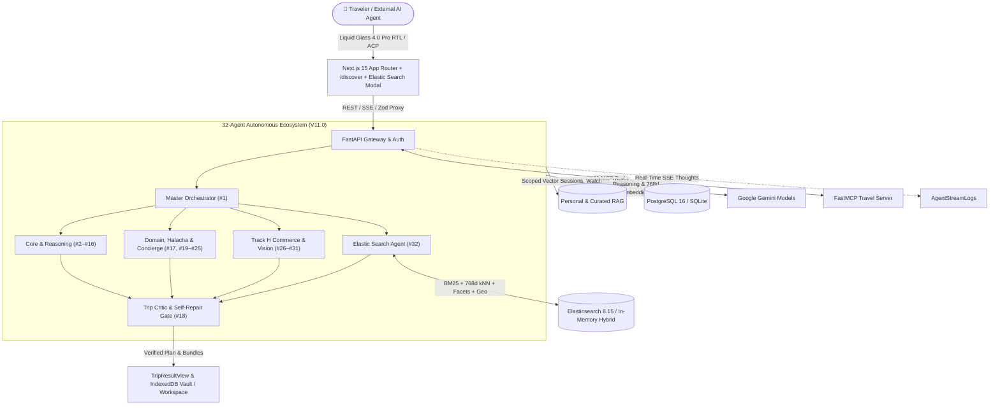

# 🌍 Wanderlust Voyage AI — AgentTravelPlanner ✈️

<div align="center">


### **Autonomous 32-Agent Travel, Hybrid Search & Agentic Commerce Platform (`V11.0`)**
*Powered by **32 Cooperating AI Agents**, **Elasticsearch 8.15 Hybrid Search (BM25 + 768d kNN RRF)**, **Vision Lookbook Matching**, **ACP/UCP Delegated Checkout**, **Proactive Fare Radar**, **Post-Booking Price Drop Guard (`₪`)**, **Personal RAG**, **FastMCP (11 Tools)**, **Next.js 15 (BiDi RTL/LTR)** & **FastAPI**.*

[](https://github.com/IDAN2468D/wanderlust-voyage-ai/actions/workflows/ci.yml)
[](https://nextjs.org/)
[](https://react.dev/)
[](https://fastapi.tiangolo.com/)
[](https://www.elastic.co/)
[](https://ai.google.dev/)
[](https://www.postgresql.org/)
[](https://zod.dev/)
[](https://www.docker.com/)

[🚀 Quick Start](#-getting-started) • [🔍 Elasticsearch 8 Hybrid](#-elasticsearch-8-hybrid-vacation-search-v110) • [🤖 32 Agents](#-the-32-autonomous-ai-agents) • [🏗️ Architecture](#️-architecture--dataflow) • [📡 API Reference](#-api-endpoints) • [🧪 Verification](#-testing--verification)

[🌐 Local Frontend](http://localhost:3000) • [🛰️ Discover Hub](http://localhost:3000/discover) • [⚡ Live Render API](https://wanderlust-voyage-ai.onrender.com) • [📚 Swagger Docs](https://wanderlust-voyage-ai.onrender.com/docs) • [🧭 Agent Registry (32)](.agents/agents.json)

</div>

---

## 🌟 Platform Overview

**Wanderlust Voyage AI (`V11.0`)** replaces dozens of hours of manual flight hunting, hotel cross-checking, Kosher/Shabbat verification, currency math, and itinerary building with a **Spec-First 5-Layer Autonomous Swarm of 32 Specialist, Meta, Commerce & Search Agents**.

| Release Track | Headline Capabilities |
|---|---|
| **V11.0 — Elasticsearch 8 Hybrid Search** | **`wanderlust_vacations_v1`** bilingual index combining fuzzy **BM25 + 768d Cosine kNN** via **Reciprocal Rank Fusion (`RRF k=60`)**, `<15ms` Edge N-Gram autocomplete, live faceted aggregations, and `geo_point` proximity filtering (`Agent #32`). |
| **V10.0 (Track H) — Agentic Commerce & Proactive AI** | Signed **ACP/UCP** external AI commerce gateway (`/.well-known/agent-commerce.json`), natural-language **Proactive Travel Interests Radar**, **Screenshot-to-Trip** pixel/EXIF vision lookbook (`-10%` bundles), **14/30d Price Drop Guard (`₪`)**, and 1-click **Sidekick Pulse**. |
| **V8–V9 — Domain Safety, Shabbat & Persistence** | Live **Ben Gurion (TLV)** holiday & baggage board, stateful **Day Re-Planner**, **Group Split & Voting**, **Shabbat/Halacha walking radius**, **Personal Owner-Scoped RAG**, **Trip Critic Self-Repair Gate**, and **Offline IndexedDB Vault**. |

---

## 🔍 Elasticsearch 8 Hybrid Vacation Search (`V11.0`)

Powered by [`elasticsearch_catalog.py`](backend/app/tools/elasticsearch_catalog.py), [`elasticsearch_vacation_tools.py`](backend/app/tools/elasticsearch_vacation_tools.py), and [`ElasticVacationSearchModal.tsx`](frontend/components/track-h/ElasticVacationSearchModal.tsx):

- **🧠 Hybrid RRF Fusion (`BM25 + 768d kNN`):** Dual-leg scoring over `wanderlust_vacations_v1` fusing bilingual fuzzy keyword matching (`fuzziness: AUTO`) and 768-dimensional `dense_vector` semantic similarity (`gemini-embedding-001` with offline Hebrew/English concept projection) via `RRF (k=60)`.
- **⚡ Sub-15ms Bilingual Autocomplete:** Custom `edge_ngram` + `search_as_you_type` analyzer predicting cities, IATA codes (`TLV`, `CDG`, `JTR`, `BUD`, `ZRH`), hotels, and vibes in Hebrew and English as you type.
- **🎛️ Live Faceted Aggregations:** Dynamic facet counts across trip styles (`ROMANTIC`, `SNOW_ALPINE`, `WELLNESS_SPA`, `KOSHER_FRIENDLY`, `CULINARY`, `BEACH_LUXURY`, `FAMILY`), star ratings, price ceiling in **ILS (`₪`)**, and Shabbat compatibility.
- **📍 `geo_point` Landmark Proximity & Radius Filter:** Filter and distance-sort resorts within radius (`km`) of iconic anchors (e.g., Eiffel Tower, Matterhorn, Oia Cliffs, Danube Parliament, Western Wall) using ES `geo_distance` & Haversine telemetry.
- **🛡️ Zero-Downtime Hybrid Fallback:** Automatically switches between a live **Elasticsearch 8.15** cluster (`AsyncElasticsearch`) and a deterministic **In-Memory 768d Hybrid Engine** so local dev, Render, and tests stay 100% green even without an active container.

---

## ✨ Core Platform Capabilities

- **⚡ Transparent Real-Time SSE Streaming:** Live multi-agent deliberation cards (`AgentStreamLogs.tsx`) stream orchestrator, domain, critic, and `[STAGE: TRACK_H_COMMERCE]` milestones without static spinners.
- **📸 Screenshot-to-Trip Vision Matcher:** Upload screenshots or paste image URLs; decodes base64/pixel EXIF GPS + visual palette & scene heuristics to generate interactive `(x, y, w, h)` bounding-box hotspots, `-10%` bundles, and `fit_accuracy_pct` suitability checks.
- **🌐 BiDi Localization (`HE` RTL ↔ `EN` LTR) & Self-Hosted Typography:** Instant direction & language switch (`LocaleContext.tsx`), Israeli `DD/MM/YYYY` formatting, tri-currency FX (`₪ ILS`, `$ USD`, `€ EUR`), and bundled `@fontsource-variable/heebo` + `@fontsource-variable/frank-ruhl-libre`.
- **🔄 Co-Pilot Day Re-Planner & Geo Map:** Pin favorite days, swap individual morning/afternoon/evening slots with structured cost diffs, and preview walking radiuses around Chabad houses.
- **💳 Sandbox Checkout, Offline Vault & Google Workspace:** Supports Visa/MC (16 digits), Amex (15 digits), Isracard (8–9 digits), `bit`, 1-click Luhn-valid demo autofill, automatic 30-day Price Guard enrollment, IndexedDB offline pass storage (`offlineVault.ts`), `.ics` calendar packs, and Gmail/Docs exports.

---

## 🤖 The 32 Autonomous AI Agents

All **32 agents** are formally registered in [`.agents/agents.json`](.agents/agents.json) and enforced by [`.agents/scripts/verify_agent_suite.py`](.agents/scripts/verify_agent_suite.py):

<details open>
<summary><strong>🏛️ Core, Domain & Reasoning Specialists (#1–#16)</strong></summary>

| # | Agent | Codename | Module | Responsibility |
|---:|---|---|---|---|
| 1 | 🧭 **Master Orchestrator** | `wanderlust-orchestrator` | [`orchestrator.py`](backend/app/agents/orchestrator.py) | Coordinates sub-agents, streams SSE deliberation, and synthesizes full itineraries. |
| 2 | 🛫 **TLV Holiday Flight Specialist** | `tlv-holiday-flight-specialist` | [`tlv_flight_board_tools.py`](backend/app/tools/tlv_flight_board_tools.py) | Ben Gurion holiday schedules, Shabbat/Chag conflicts, full baggage math & BOI FX. |
| 3 | ✈️ **Flight Specialist** | `flight-specialist` | [`flight_tools.py`](backend/app/tools/flight_tools.py) | Evaluates routes, layovers, airline blocks, and true airfare pricing. |
| 4 | 🏨 **Places & Hotel Specialist** | `places-specialist` | [`places_tools.py`](backend/app/tools/places_tools.py) | Curates top hotels, landmarks, and restaurants with Nominatim & Maps links. |
| 5 | ⛅ **Weather & Packing Specialist** | `weather-packing-specialist` | [`weather_tools.py`](backend/app/tools/weather_tools.py) | Open-Meteo forecasts, rain probabilities, and seasonal packing checklists. |
| 6 | 🛡️ **Safety Advisory Specialist** | `safety-advisory-specialist` | [`safety_tools.py`](backend/app/tools/safety_tools.py) | Passport validity windows, visa policies, embassy hotlines, and health rules. |
| 7 | 🎭 **Culture & Events Specialist** | `culture-events-specialist` | [`events_tools.py`](backend/app/tools/events_tools.py) | Live seasonal festivals, concerts, sunset spots, and neighborhood gems. |
| 8 | 💰 **Budget Optimizer** | `budget-optimizer` | [`budget_tools.py`](backend/app/tools/budget_tools.py) | Frankfurter tri-currency FX (`₪`/`$`/`€`) + strict 10% contingency reserve. |
| 9 | 🚇 **Transit Navigator** | `transit-navigator` | [`transit_tools.py`](backend/app/tools/transit_tools.py) | City transit passes (Navigo, Oyster, Suica), airport trains, and walkability. |
| 10 | 🍽️ **Culinary & Kosher Specialist** | `culinary-kosher-specialist` | [`culinary_tools.py`](backend/app/tools/culinary_tools.py) | Glatt kosher dining, Chabad centers, street food, and tipping etiquette. |
| 11 | 🛍️ **Shopping & Tax-Free Specialist** | `shopping-taxfree-specialist` | [`shopping_tools.py`](backend/app/tools/shopping_tools.py) | VAT refund thresholds and airport digital customs kiosks (PABLO, DIVA). |
| 12 | 📅 **Calendar & Workspace Syncer** | `calendar-workspace-syncer` | [`calendar_tools.py`](backend/app/tools/calendar_tools.py) | RFC 5545 `.ics` itinerary bundles + Google Calendar, Docs & Resend sync. |
| 13 | 🚨 **Ground Sentinel** | `ground-sentinel` | [`sentinel_tools.py`](backend/app/tools/sentinel_tools.py) | Scans transit strike risks, local scam alerts, and emergency dispatch info. |
| 14 | 📱 **WhatsApp Concierge Butler** | `whatsapp-concierge-butler` | [`briefing_tools.py`](backend/app/tools/briefing_tools.py) | Formats clean daily WhatsApp-ready briefings with 1-click sharing. |
| 15 | 🧠 **Knowledge RAG Specialist** | `knowledge-rag-specialist` | [`retriever.py`](backend/app/rag/retriever.py) | Bilingual VectorStore retrieval across travel handbooks and Tax-Free rules. |
| 16 | 🧩 **Reasoning Audit Specialist** | `reasoning-audit-specialist` | [`reasoning.py`](backend/app/agents/reasoning.py) | 4-stage Chain-of-Thought reasoning over dates, budget, RAG, and pacing. |

</details>

<details open>
<summary><strong>🛡️ Sprint 8–9 Reliability, Halacha, Concierge & Quality Gate (#17–#25)</strong></summary>

| # | Agent | Codename | Module | Responsibility |
|---:|---|---|---|---|
| 17 | 🔄 **Trip Disruption Re-Plan Specialist** | `trip-disruption-replan-specialist` | [`replan_tools.py`](backend/app/tools/replan_tools.py) | Stateful day/slot swapping with real-time budget & calendar diffs. |
| 18 | ✅ **Trip Critic Meta-Agent** | `trip-critic-meta-agent` | [`critic.py`](backend/app/agents/critic.py) | Mandatory pre-completion audit & auto-repair gate across all invariants. |
| 19 | 🪪 **Travel Memory Specialist** | `travel-memory-specialist` | [`memory_tools.py`](backend/app/tools/memory_tools.py) | DB-persisted preferences, passport checks, and user-isolated Personal RAG. |
| 20 | 🕯️ **Shabbat & Halacha Strategist** | `shabbat-halacha-specialist` | [`shabbat_halacha_tools.py`](backend/app/tools/shabbat_halacha_tools.py) | Candle-lighting, Havdalah, Friday 14:00 cutoff, mechanical keys & Eruv radii. |
| 21 | 👥 **Group Split Specialist** | `group-split-specialist` | [`group_split_tools.py`](backend/app/tools/group_split_tools.py) | Multi-traveler cost splitting (adults/children), voting & Bit settlements. |
| 22 | 📶 **Connectivity & Mobility Specialist** | `connectivity-mobility-specialist` | [`connectivity_mobility_tools.py`](backend/app/tools/connectivity_mobility_tools.py) | eSIM comparisons plus IDP, ZTL/LEZ zones, highway vignettes & CDW checks. |
| 23 | ⚖️ **Protection & Rerouting Specialist** | `protection-rerouting-specialist` | [`protection_rerouting_tools.py`](backend/app/tools/protection_rerouting_tools.py) | Travel insurance audits, MCT layover Plan B, Tibi Law & EU261 rights. |
| 24 | 💎 **Loyalty & Vault Specialist** | `loyalty-vault-specialist` | [`loyalty_vault_tools.py`](backend/app/tools/loyalty_vault_tools.py) | Matmid / Fly Card / Flying Blue redemption valuation & TLV lounge access. |
| 25 | 🛎️ **Post-Booking Concierge Watchdog** | `post-booking-concierge-watchdog` | [`concierge_tools.py`](backend/app/tools/concierge_tools.py) | T-30d / T-7d / T-24h readiness timelines & DB-backed HITL approvals. |

</details>

<details open>
<summary><strong>🛰️ Sprint 10–11 Commerce, Vision & Elasticsearch 8 Hybrid Search (#26–#32)</strong></summary>

| # | Agent | Codename | Module | Responsibility |
|---:|---|---|---|---|
| 26 | 🌐 **External Agent Handshake (ACP/UCP)** | `external-agent-handshake-specialist` | [`acp_gateway_tools.py`](backend/app/tools/acp_gateway_tools.py) | HMAC-signed commerce manifest, `DelegatedSpendToken` (`₪`) & atomic checkouts. |
| 27 | 🛰️ **Interests Watchdog Scout** | `interests-watchdog-specialist` | [`interests_scout_tools.py`](backend/app/tools/interests_scout_tools.py) | Monitors Hebrew/English deal wishes with VIP 15-minute auto-reserve holds. |
| 28 | 📸 **Vision Lookbook Matcher** | `vision-lookbook-specialist` | [`vision_trip_tools.py`](backend/app/tools/vision_trip_tools.py) | Decomposes photos into `(x, y, w, h)` hotspots (`-10%` bundles) & fit scores. |
| 29 | 🛡️ **Post-Booking Price Drop Guard** | `post-booking-price-guard-specialist` | [`price_guard_tools.py`](backend/app/tools/price_guard_tools.py) | Watches 14/30-day fare & hotel drops and credits `₪ ILS` directly to Wallet. |
| 30 | ⚡ **Travel Pulse Autopilot** | `travel-pulse-autopilot-specialist` | [`pulse_negotiator_tools.py`](backend/app/tools/pulse_negotiator_tools.py) | Turns live TLV, FX & booking telemetry into 1-click Sidekick Pulse cards. |
| 31 | 🤝 **Bundle Deal Negotiator** | `bundle-deal-negotiator-specialist` | [`pulse_negotiator_tools.py`](backend/app/tools/pulse_negotiator_tools.py) | Negotiates dynamic Flight + Hotel + eSIM/Transfer bundle discounts. |
| 32 | 🔍 **Elastic Vacation Search Specialist** | `elastic-vacation-search-specialist` | [`elasticsearch_vacation_tools.py`](backend/app/tools/elasticsearch_vacation_tools.py) | **Elasticsearch 8 Hybrid BM25 + 768d kNN (RRF)**, `<15ms` autocomplete, facets & `geo_point` ranking. |

</details>

---

## 🏗️ Architecture & Dataflow



---

## 🚀 Getting Started

### Prerequisites
- [Docker](https://www.docker.com/) & [Docker Compose](https://docs.docker.com/compose/)
- [Node.js 20+](https://nodejs.org/)
- [Python 3.11+](https://www.python.org/)
- Optional: `GEMINI_API_KEY` ([Google AI Studio](https://ai.google.dev/)) — all search, planning, vision, and commerce flows also operate seamlessly in deterministic offline fallback mode.

### Option 1: Docker Compose (Full Stack + PostgreSQL 16 + Elasticsearch 8.15) 🐳

```bash
git clone https://github.com/IDAN2468D/wanderlust-voyage-ai.git
cd wanderlust-voyage-ai

cp .env.example .env
cp backend/.env.example backend/.env

docker compose up --build -d
```

- **Frontend Portal & Search:** [http://localhost:3000](http://localhost:3000)
- **Track H Discovery & Elastic Hub:** [http://localhost:3000/discover](http://localhost:3000/discover)
- **FastAPI Backend & Swagger:** [http://localhost:8000](http://localhost:8000) • [http://localhost:8000/docs](http://localhost:8000/docs)
- **Elasticsearch 8.15 Cluster:** [http://localhost:9200](http://localhost:9200) (`wanderlust_vacations_v1`)

### Option 2: Local Development 💻

```bash
# Terminal 1 — FastAPI Backend
cd backend
python -m venv .venv && source .venv/bin/activate   # Windows: .venv\Scripts\activate
pip install -r requirements.txt
uvicorn app.main:app --reload --port 8000

# Terminal 2 — Next.js 15 Frontend
cd frontend
npm install
npm run dev
```

---

## 📡 API Endpoints

| Method | Path | Purpose |
|---|---|---|
| `GET` | `/health` | Service health, build version, and active Gemini model posture |
| `GET` | `/.well-known/agent-commerce.json` | Signed ACP/UCP external agent discovery manifest (`HMAC-SHA256`) |
| `GET` | `/api/v1/trips/stream` | Real-time SSE channel streaming multi-agent deliberation & Track H stage |
| `POST` | `/api/v1/trips/plan` | Synchronous itinerary generation with Critic audit & `track_h_insights` |
| `POST` | `/api/v1/search/vacations` | **Elasticsearch 8 Hybrid Search** (`BM25 + 768d kNN RRF`, facets, `geo_point` radius) |
| `GET` | `/api/v1/search/vacations/autocomplete` | Sub-15ms Edge N-Gram & IATA bilingual autocomplete |
| `GET` / `POST` | `/api/v1/search/vacations/status` & `/reindex` | Cluster/hybrid status, 768d mapping telemetry & bulk index seeding |
| `POST` | `/api/v1/acp/tokens/delegate` & `/acp/checkout` | Mint bounded `DelegatedSpendToken` (`₪`) and execute atomic AI checkout |
| `GET` / `POST` | `/api/v1/interests` & `/interests/{id}/evaluate` | Create & scan natural-language Proactive Travel Interest watchers |
| `POST` | `/api/v1/vision-trip/decompose-screenshot` & `/fit-assessment` | Screenshot-to-Trip hotspot extraction, `-10%` bundles & fit score |
| `GET` / `POST` | `/api/v1/price-guard`, `/register` & `/scan-drops` | 14/30-day Price Drop Protection & automatic `₪` Wallet credits |
| `GET` / `POST` | `/api/v1/pulse/actions`, `/execute` & `/trips/negotiate-bundle` | Sidekick TravelOps Pulse cards & dynamic bundle negotiation |
| `POST` | `/api/v1/trips/{session_id}/replan` & `/replan/stream` | Stateful day/slot replanner with structured diffs & SSE stream |
| `POST` | `/api/v1/trips/{session_id}/group-split` & `/vote` | Multi-traveler settlement ledger & collaborative voting |
| `GET` / `PUT` | `/api/v1/profile/preferences` & `/knowledge/ingest-personal` | Persistent traveler preferences & owner-isolated Personal RAG |
| `GET` | `/api/v1/ops/live-pulse` & `/ops/metrics` | Live TLV FX rates & **32-agent** operational telemetry |

> **🔌 FastMCP Server ([`travel_mcp_server.py`](backend/app/mcp/travel_mcp_server.py)):** Exposes **11 MCP tools**, including `search_flights`, `get_destination_weather`, `calculate_trip_budget`, `search_travel_knowledge`, `replan_trip_day`, `get_booking_readiness_timeline`, `get_acp_commerce_manifest`, `create_travel_interest_watcher`, `decompose_travel_screenshot`, `scan_booking_price_drops`, and **`search_vacations_elasticsearch`**.

---

## 🧪 Testing & Verification

```bash
# 1. Backend full pytest suite (89 tests) + compile & lint check
backend/.venv/bin/pytest backend/tests/ -v
backend/.venv/bin/python -m compileall -q backend/app
backend/.venv/bin/python -m flake8 backend/app backend/tests --select=E9,F63,F7,F82 --show-source

# 2. Spec-First agent & skills contract check (15 Skills + 32 Registered Agents)
python3 .agents/scripts/verify_agent_suite.py

# 3. Frontend TypeScript strict check & Next.js 15 production build
cd frontend && npx tsc --noEmit && npm run build
```

---

<div align="center">

Distributed under the **MIT License** • See [`LICENSE`](LICENSE) for details.

**Built with ❤️ for travelers worldwide by the Wanderlust Voyage AI Team.**

</div>
